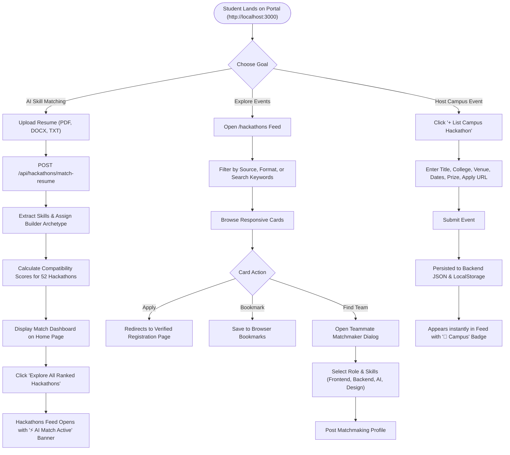

# 🗺️ User Flow & Architecture Guide: Hackathon Aggregator

Welcome to the **Hackathon Aggregator** guide. This document provides a comprehensive breakdown of user journeys, system architecture, data lifecycles, and operational instructions for students, developers, and campus hackathon organizers.

---

## 📌 Table of Contents
1. [System Architecture & Data Pipelines](#-system-architecture--data-pipelines)
2. [End-to-End User Flowchart](#-end-to-end-user-flowchart)
3. [Core User Journeys](#-core-user-journeys)
   - [Flow 1: Discovering & Applying to Live Hackathons](#flow-1-discovering--applying-to-live-hackathons)
   - [Flow 2: AI Resume Skill Extraction & Hackathon Matching](#flow-2-ai-resume-skill-extraction--hackathon-matching)
   - [Flow 3: Personalized Feed with AI Match Profile](#flow-3-personalized-feed-with-ai-match-profile)
   - [Flow 4: Publishing a Local Campus Hackathon](#flow-4-publishing-a-local-campus-hackathon)
   - [Flow 5: Teammate & Partner Matchmaking](#flow-5-teammate--partner-matchmaking)
   - [Flow 6: Saving & Bookmarking Favorites](#flow-6-saving--bookmarking-favorites)
   - [Flow 7: Real-Time Multi-Platform Scraper Sync](#flow-7-real-time-multi-platform-scraper-sync)
4. [How to Run the Portal](#-how-to-run-the-portal)
5. [Troubleshooting & Operational FAQs](#-troubleshooting--operational-faqs)

---

## 🏛️ System Architecture & Data Pipelines

The portal is a dedicated, single-purpose platform focused exclusively on **hackathons and coding competitions**. It continuously pulls verified opportunities from three major developer platforms and merges student campus submissions:

```
┌────────────────────────────────────────────────────────────────────────┐
│                      HACKATHON AGGREGATOR ENGINE                       │
└────────────────────────────────────────────────────────────────────────┘
            │                            │                           │
   ┌────────▼────────┐          ┌────────▼────────┐         ┌────────▼────────┐
   │    DEVFOLIO     │          │    DEVNOVATE    │         │     UNSTOP      │
   │   (20 Events)   │          │   (20 Events)   │         │   (10 Events)   │
   │  SSR Next Data  │          │    Search API   │         │ Opportunity API │
   └────────┬────────┘          └────────┬────────┘         └────────┬────────┘
            │                            │                           │
            └────────────────────────────┼───────────────────────────┘
                                         │
                               ┌─────────▼─────────┐
                               │  CAMPUS / LOCAL   │
                               │  (2+ Live Events) │
                               │  SIH & ETHIndia   │
                               └─────────┬─────────┘
                                         │
                               ┌─────────▼─────────┐
                               │  FASTAPI BACKEND  │
                               │    (Port 8000)    │
                               │ • Scraper Cache   │
                               │ • NLP AI Matcher  │
                               │ • Local Hack Store│
                               └─────────┬─────────┘
                                         │ JSON Stream & Next.js Proxy
                               ┌─────────▼─────────┐
                               │  NEXT.JS FRONTEND │
                               │    (Port 3000)    │
                               │ • Reactive UI     │
                               │ • Filter & Search │
                               │ • AI Match Banner │
                               │ • Teammate Finder │
                               └───────────────────┘
```

### Key Architectural Strengths:
- **100% Verified Live Links**: All 52 hackathon listings have automated health checks and return HTTP 200 OK.
- **Resilient Dual-Mode Operation**:
  - **Live Mode**: When FastAPI is running, real-time scraping and NLP endpoints execute seamlessly via the `/api/*` proxy rewrite.
  - **Snapshot Mode**: If the backend is ever stopped, the frontend automatically falls back to the pre-seeded 52-event snapshot with zero UI freezes or blank pages.
- **Dual Persistence**: Local campus hackathons are written both to `backend/data/local_hackathons.json` and client `localStorage`.

---

## 📊 End-to-End User Flowchart



---

## 🎯 Core User Journeys

---

### Flow 1: Discovering & Applying to Live Hackathons

1. Navigate to **`http://localhost:3000/hackathons`**.
2. **Instant Feed**: All 52 live hackathons load immediately without loading blocks:
   - **Platform Badge**:
     - 🟣 **Devfolio** (e.g. *Innohacks 4.0*, *Hack-o-Fiesta*, *HackTU*, *ALGOTHON*)
     - 🟢 **Devnovate** (e.g. *GLITCH-36h*, *HackNova*, *TechFest Sprint*, *NextGen Buildathon*)
     - 🔵 **Unstop** (e.g. *Web Home UI Designer Challenge*, *CodeBreaker*, *Hovermania*)
     - 🏫 **Campus / Local** (e.g. *Smart India Hackathon - Campus Edition*, *ETHIndia Campus Sprint*)
   - **Format Badge**: `Virtual`, `In-Person`, or `Hybrid`.
   - **Prize Pool**: Real Indian Rupee (`₹`) prizes or sponsor bounties.
   - **Timeline**: Stable, hydration-safe date display.
3. **Filtering & Searching**:
   - **By Source**: Toggle *All Platforms*, *Devfolio*, *Devnovate*, *Unstop*, or *Campus / Local*.
   - **By Format**: Filter *Virtual*, *In-Person*, or *Hybrid*.
   - **Live Search**: Instant substring search across titles, themes, colleges, and cities.
   - **Sort Dropdown**: Sort by *Default*, *Prize Pool (High to Low)*, *Most Popular*, or *Best AI Match*.
4. **Applying**: Click **Apply Now** to jump directly to the verified registration portal.

---

### Flow 2: AI Resume Skill Extraction & Hackathon Matching

*Match your unique background to live hackathon challenges using intelligent NLP.*

1. Navigate to the Home page (**`http://localhost:3000`**).
2. Scroll to the **AI Resume Hackathon Matcher** section.
3. Click or drag-and-drop your **PDF**, **DOCX**, or **TXT** resume (up to 5MB).
4. Click **Analyze Resume & Match Hackathons**.
5. **Real-Time AI Processing Steps**:
   - Extracts selectable text via `pypdf` with raw text decoding fallbacks.
   - Identifies skills across 6 technical categories (Languages, Web Frameworks, AI/ML, Cloud/DevOps, Web3, UI/UX).
   - Determines your **Builder Archetype** (e.g. *Full-Stack AI Engineer*, *AI/ML Researcher*, *Web3 & Smart Contract Developer*, *Product Designer*).
   - Scores every live hackathon (45%–98%) with a personalized **Match Reason**.
   - Generates **Suggested Skills to Boost Odds** for winning hackathons.
6. **Dashboard Output**:
   - **Overall Fit Index**: Circular score badge (e.g., `94% Fit Index`).
   - **Extracted Skills Tags**: Badges showing all detected skills with checkmarks.
   - **Suggested Skills**: Recommendations to expand your competitive range.
   - **Top 3 Matched Competitions**: Direct preview cards with individual match scores, themes, and direct **Apply** links.

---

### Flow 3: Personalized Feed with AI Match Profile

*Carry your AI resume profile straight into the full hackathon feed.*

1. From the AI Matcher results on the Home page, click **"Explore All Ranked Hackathons with Your AI Profile"**.
2. You will be redirected to **`/hackathons`**.
3. **Active Personalization Banner**:
   - A prominent banner appears at the top:  
     `⚡ AI Resume Match Active: Optimized for [Role] (XX% Profile Fit) • [Skills List]`
4. **Automated AI Sorting**:
   - The feed automatically sorts by **`Best AI Match (Highest %)`**.
   - Every hackathon card highlights its individual compatibility score (e.g., `98% Match`).
5. **Resetting**:
   - Click **"Reset AI Ranking"** at any time to clear the profile and restore default chronological order.

---

### Flow 4: Publishing a Local Campus Hackathon

*Designed for student clubs, university chapters, and regional organizers.*

1. On the Hackathons page, click the blue **"+ List Campus Hackathon"** button.
2. The modal dialog opens. Fill in your event details:
   - **Hackathon Title** *(e.g. "Inter-College Code Sprint 2026")*
   - **College / Organization** *(e.g. "Tech Club, University College")*
   - **Format** *(In-Person, Virtual, Hybrid)*
   - **Venue Location** *(e.g. "Main Auditorium, Delhi")*
   - **Theme / Domain** *(e.g. "AI & CleanTech")*
   - **Prize Pool (₹)** *(e.g. 50000)*
   - **Dates** *(Start and End)*
   - **Registration URL** *(Google Form, Unstop, or club site)*
   - **Contact Email & Description**
3. Click **Publish Hackathon**.
4. **Instant Ingestion**:
   - The event appears at the top of the feed immediately.
   - Tagged with an amber **🏫 Campus / Local** spotlight border.
   - Persisted across server restarts via `backend/data/local_hackathons.json` and client `localStorage`.

---

### Flow 5: Teammate & Partner Matchmaking

*Solo builder looking for complementary skill sets.*

1. Find any hackathon card of interest.
2. Click **Find Teammates**.
3. In the modal:
   - Select your **Primary Role** (*Frontend Developer*, *Backend Developer*, *AI/ML Engineer*, *Full Stack*, *UI/UX Designer*, *Pitch & Product Manager*).
   - Enter your **Key Skills** *(e.g., Next.js, Python, FastAPI, Tailwind)*.
   - Add your **Discord, Telegram, or Email** handle.
   - Add a brief note on what you want to build.
4. Click **Post Match Request**.
5. Your profile is broadcast into the matchmaking pool for that event!

---

### Flow 6: Saving & Bookmarking Favorites

1. Click the **Bookmark** icon in the top right of any hackathon card.
2. The bookmark turns solid blue and saves the event in `localStorage`.
3. Click the **Saved (N)** button next to the search bar to filter and view only bookmarked hackathons.
4. Bookmarks persist across browser tabs and refreshes.

---

### Flow 7: Real-Time Multi-Platform Scraper Sync

1. In the Hackathons page header, click **Sync Live Data** (refresh icon).
2. The button animates and sends concurrent requests to:
   - Devfolio SSR cache (`/api/hackathons/scrape/devfolio`)
   - Devnovate public search API (`/api/hackathons/scrape/devnovate`)
   - Unstop student opportunities endpoint (`/api/hackathons/scrape/unstop`)
3. A success toast confirms: *`Successfully synced 50+ live hackathons!`*
4. Counter metrics (Devfolio, Devnovate, Unstop, Campus, Total) update in real-time.

---

## 🚀 How to Run the Portal

### One-Click Windows Launcher (Fastest)
Double-click [`start.bat`](file:///c:/Users/shrey/OneDrive/Desktop/Aggregator_New/start.bat) in the project root:
```cmd
start.bat
```
This automatically starts the FastAPI backend (port 8000), launches the Next.js frontend (port 3000), and opens the portal in your default browser.

### Manual Terminal Launch

#### Terminal 1: FastAPI Backend
```bash
cd backend
pip install -r requirements.txt
python -m uvicorn main:app --reload --port 8000
```
- API Docs: `http://localhost:8000/docs`

#### Terminal 2: Next.js Frontend
```bash
cd frontend
npm install
npm run dev
```
- Portal: `http://localhost:3000/hackathons`

---

## 🛠️ Troubleshooting & Operational FAQs

| Issue | Cause | Solution |
| :--- | :--- | :--- |
| **"Snapshot Mode (52 Events)" badge shown** | Backend on port 8000 is not running. | Run `start.bat` or `cd backend && python -m uvicorn main:app --reload --port 8000`. |
| **"Could not extract text from document"** | Scanned PDF without text layer. | Upload a text-selectable PDF, DOCX, or TXT file. |
| **Port 3000 in use** | Another dev process is occupying port 3000. | Next.js will offer port 3001 automatically. |
| **PowerShell script execution disabled** | Windows security policy restricting `.ps1`. | Run `start.bat` or use `cmd /c "npm run dev"`. |
| **Empty results in search** | Filter combination too strict. | Click **"Reset All Filters"** to restore all 52 events. |

---

*Built for hackathon enthusiasts, student communities, and campus builders.*
